# Projects built for real workflows

A catalogue of public projects across local-first products, agent reliability,
Rust desktop software, graph systems, and developer tooling. The original
35-project collection is retained below, with newer work added here.

For the current introduction, [return to my profile](./Readme.md).
Planning with Files passed 28,000 GitHub stars in the November 2026 snapshot.

## Recent products and additional systems

| Project | What it does | Open it |
|---|---|---|
| [zero-to](https://github.com/OthmanAdi/zero-to) | An agent skill that researches a topic, checks resources and builds an interactive learning roadmap. | [Live gallery](https://othmanadi.github.io/zero-to/gallery/) |
| [Bookmark Bookshelf](https://github.com/OthmanAdi/bookmark-bookshelf) | Local-first bookmark and reading software, with saved links represented as books. | [Live app](https://othmanadi.github.io/bookmark-bookshelf/) |
| [sketchy](https://github.com/OthmanAdi/sketchy) | Hand-drawn slides, charts and teaching explainers as self-contained HTML, with export tools. Demo figures in its gallery are fictional examples. | [Live examples](https://othmanadi.github.io/sketchy/) |
| [StateAssure](https://github.com/OthmanAdi/StateAssure) | A Windows C++20 metadata scanner for AI memory and index stores, with explicit coverage reporting. | [Releases](https://github.com/OthmanAdi/StateAssure/releases) |
| [Commit FM](https://github.com/OthmanAdi/commit-fm) | A profile radio display generated from public GitHub push history. | [Source and setup](https://github.com/OthmanAdi/commit-fm) |

## Learning applications

| Project | Learning task |
|---|---|
| [Die Begriffsakte](https://github.com/OthmanAdi/laravel-ai-begriffsatlas) | Explore Laravel and Applied AI concepts at different depths, then apply and explain them. [Open the atlas](https://othmanadi.github.io/laravel-ai-begriffsatlas/). |
| [Request-Labor](https://github.com/OthmanAdi/laravel-request-pipeline-warmup) | Follow a Laravel request through its pipeline, complete exercises and export a local completion record. |

These public examples show learning-product engineering. They are not presented
as the historical applications developed for every institution in my teaching record.

Previous portfolio overview, preserved as a historical snapshot

The earlier overview below described 35 selected projects, four featured
products, 26K+ Planning with Files stars and one published Rust crate. Current
project and release information is linked in the catalogue.

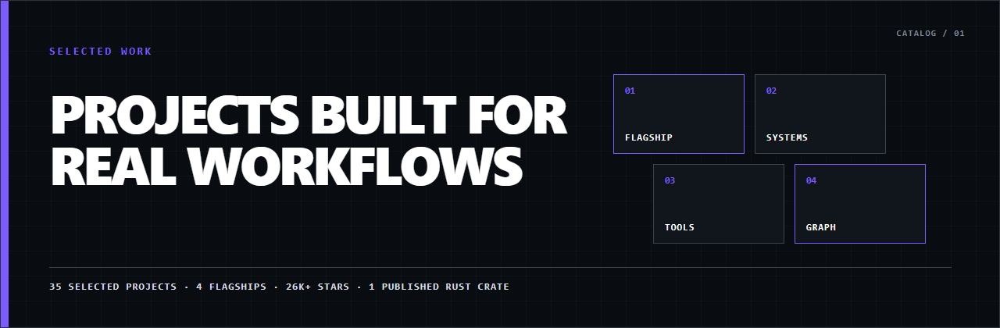

## Browser and desktop products

| Project | What it does | Core stack |
|---|---|---|
| [BunBite](https://github.com/OthmanAdi/bunbite) | Free, local-first WebP, JPEG, and PNG optimization for web and browser workflows. | Bun, TypeScript, SQLite, Canvas |
| [BunBite Studio](https://github.com/OthmanAdi/bunbite-extension) | Chromium Manifest V3 extension for local image optimization. | JavaScript, Chromium MV3 |
| [Skill Deck](https://github.com/OthmanAdi/skill-deck) | Discovers and catalogs AI-agent artifacts for search and manual review. | Rust, Tauri, Svelte |
| [INDEX](https://github.com/OthmanAdi/index) | Local governance and risk classification for supported agent artifacts. | Rust, Tauri, Svelte |

Open the original four-product visual collection

<a href="https://github.com/OthmanAdi/bunbite">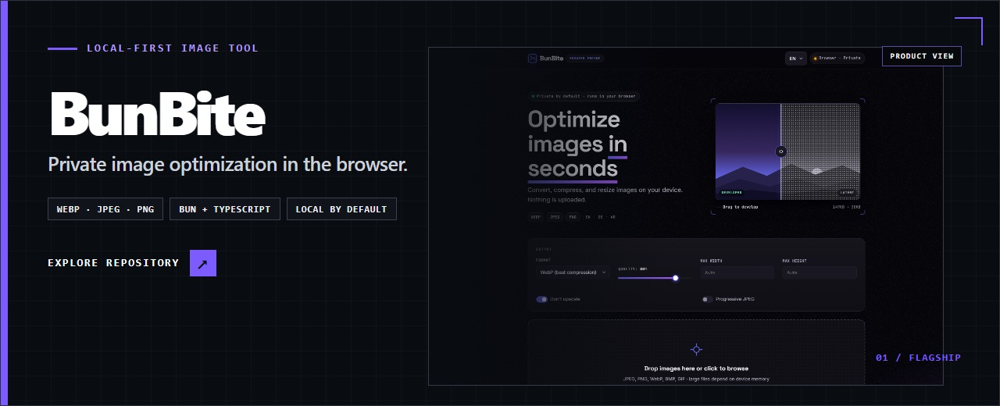</a>
<a href="https://github.com/OthmanAdi/bunbite-extension">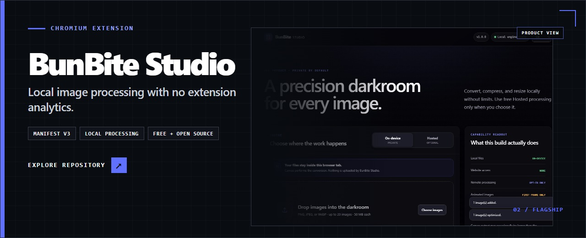</a>
<a href="https://github.com/OthmanAdi/skill-deck">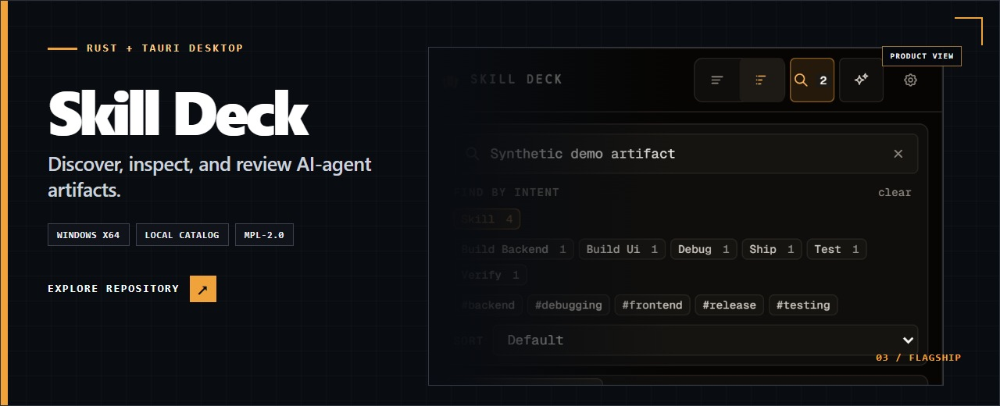</a>
<a href="https://github.com/OthmanAdi/index">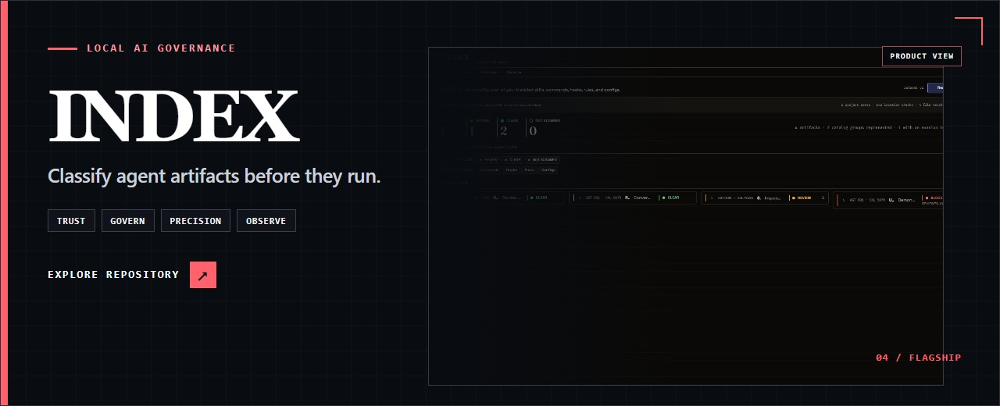</a>

## Planning, interfaces and graph systems

<a href="https://github.com/OthmanAdi/planning-with-files" title="Open the Planning with Files repository">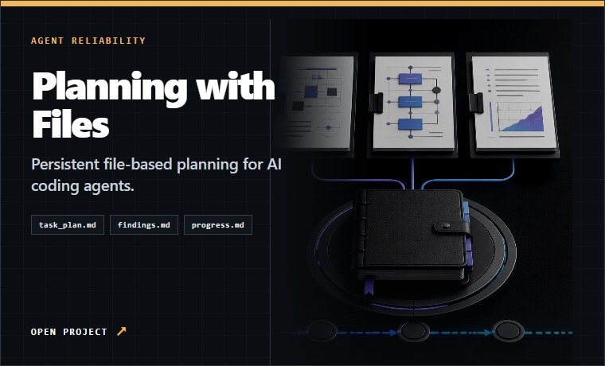</a>
<a href="https://github.com/OthmanAdi/plandeck" title="Open the Plandeck repository">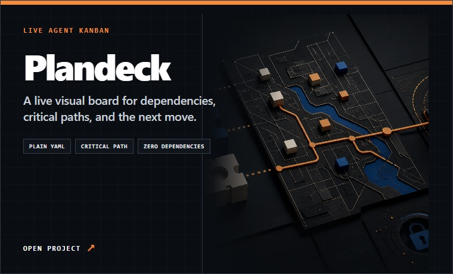</a>

<a href="https://github.com/OthmanAdi/loophole" title="Open the Loophole repository">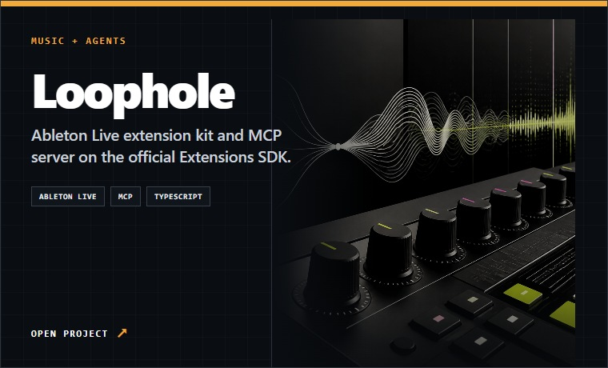</a>
<a href="https://github.com/OthmanAdi/openui-forge" title="Open the OpenUI Forge repository">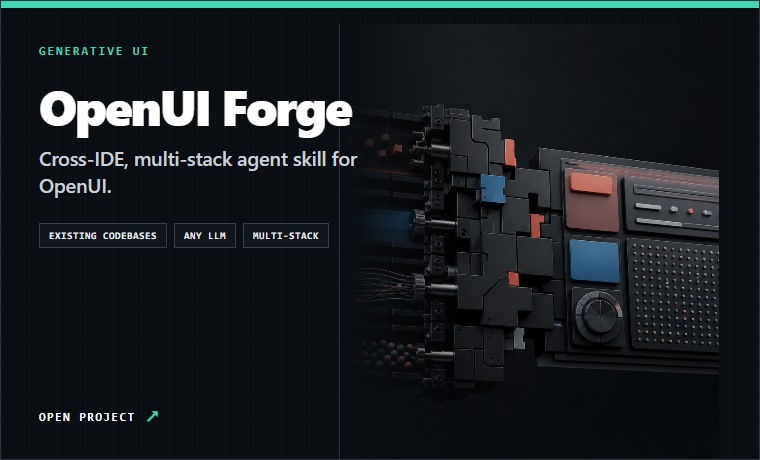</a>

<a href="https://github.com/OthmanAdi/ai-model-directory-router-rs" title="Open the AI Model Directory Router repository">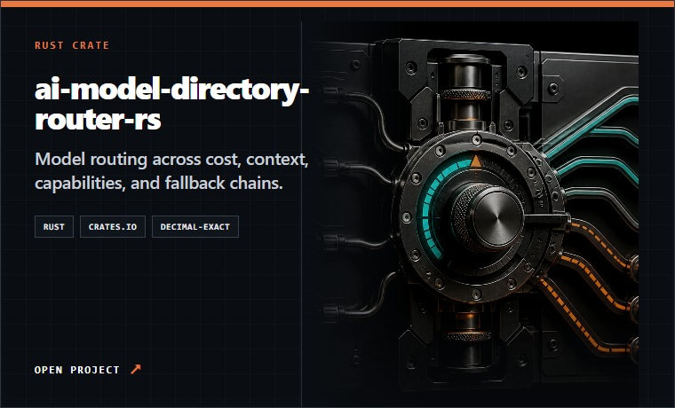</a>
<a href="https://github.com/OthmanAdi/OpenMark" title="Open the OpenMark repository">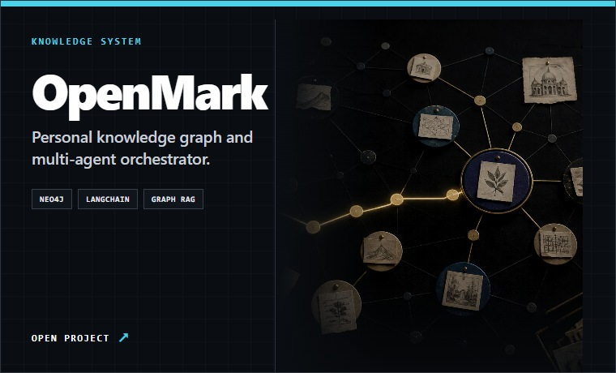</a>

## Agent reliability and orchestration

Persistent state, visual control, attested output, team coordination, and
recoverable workflows.

| Project | Focus |
|---|---|
| [planning-with-files](https://github.com/OthmanAdi/planning-with-files) | Persistent plans, findings, and progress for long-running coding-agent work. |
| [plandeck](https://github.com/OthmanAdi/plandeck) | Visual dependency-aware Kanban for agent plans. |
| [plan-it](https://github.com/OthmanAdi/plan-it) | HTML-first visual planning with reusable templates and SHA-256-attested output. |
| [planning-with-teams](https://github.com/OthmanAdi/planning-with-teams) | Shared planning files for coordinated parallel agents. |
| [chronos](https://github.com/OthmanAdi/chronos) | Time-aware ledger and decision rules for coding agents. |
| [MDDesign](https://github.com/OthmanAdi/MDDesign) | Orchestrates planning, design tokens, memory routing, agent teams, and session handoffs. |
| [cowork-workflows](https://github.com/OthmanAdi/cowork-workflows) | Recoverable workflow checkpoints for Cowork tasks. |
| [codebase-knowledge-builder](https://github.com/OthmanAdi/codebase-knowledge-builder) | Structured codebase knowledge for cold-start agent sessions. |
| [code-memory-router](https://github.com/OthmanAdi/code-memory-router) | Routes different memory questions to the right retrieval system. |

## AI developer infrastructure

| Project | Focus |
|---|---|
| [openui-forge](https://github.com/OthmanAdi/openui-forge) | Integrates OpenUI into existing projects across multiple LLM providers, backend stacks, and agent platforms. |
| [langsmith-fetch](https://github.com/OthmanAdi/langsmith-fetch-skill) | LangChain and LangGraph trace retrieval in the terminal. |
| [AI-Docs-Copier](https://github.com/OthmanAdi/AI-Docs-Copier) | Converts documentation sites into clean Markdown for AI tools. |
| [researchclaw](https://github.com/OthmanAdi/researchclaw-skill) | Multi-stage research workflow from topic to structured paper. |
| [agent-blueprint](https://github.com/OthmanAdi/agent-blueprint) | Production patterns for tool registries, streaming, human review, and serving. |
| [APEX](https://github.com/OthmanAdi/APEX) | Structured replatforming workflows with multiple autonomy tiers. |
| [open-responses-agent-skill](https://github.com/OthmanAdi/open-responses-agent-skill) | Multi-provider agent workflows shaped around the Responses API model. |
| [pr-perfect](https://github.com/OthmanAdi/pr-perfect) | Repository-aware pull-request descriptions and review preparation. |
| [humanizer-semitic](https://github.com/OthmanAdi/humanizer-semitic) | Arabic and Hebrew editing patterns for more natural writing. |
| [vibe-skills](https://github.com/OthmanAdi/vibe-skills) | Website-building skills with explicit design constraints. |
| [awesome-here-now](https://github.com/OthmanAdi/awesome-here-now) | Catalogue of sites and patterns published with here.now. |

## Rust, desktop, and media systems

| Project | Focus |
|---|---|
| [loophole](https://github.com/OthmanAdi/loophole) | Ableton Live control from coding agents and LLM tools through Ableton's Extensions SDK. |
| [YouTube-Clipper](https://github.com/OthmanAdi/YouTube-Clipper) | Captures audio, transcript, structured notes, and a publishable page from a selected clip. |
| [kickbacks-kit](https://github.com/OthmanAdi/kickbacks-kit) | Local SQLite archive and Rust TUI for kickbacks.ai advertising history. |
| [ai-model-directory-router-rs](https://github.com/OthmanAdi/ai-model-directory-router-rs) | Published [Rust crate](https://docs.rs/ai-model-directory-router/latest/ai_model_directory_router/) for decimal-exact model routing across cost, context, capabilities, and fallback chains. |
| [promptfusion](https://github.com/OthmanAdi/promptfusion) | Combines three weighted prompt layers to make instruction priority explicit. |

## Graph and Neo4j systems

| Project | Focus |
|---|---|
| [langgraph-checkpoint-neo4j-js](https://github.com/OthmanAdi/langgraph-checkpoint-neo4j-js) | LangGraph checkpoints, branching, and history stored in Neo4j. |
| [OpenMark](https://github.com/OthmanAdi/OpenMark) | Knowledge graph for large bookmark collections. |
| [schema-architect](https://github.com/OthmanAdi/schema-architect) | Schema generation across SQLite, Redis, and Neo4j. |

## Web products and utilities

| Project | Focus |
|---|---|
| [BarbersBuddies](https://github.com/OthmanAdi/BarbersBuddies_Onlineshop_maker) | [Live web product](https://barbersbuddies.com/) for barbershop booking, payments, messaging, and staff workflows. |
| [Mystic Portfolio](https://github.com/OthmanAdi/Mystic-Portfolio) | Multilingual portfolio with RTL and dark-mode support. |
| [appwrite-keepalive](https://github.com/OthmanAdi/appwrite-keepalive) | Scheduled activity that prevents an Appwrite development project from pausing. |

## Professional product context

These company pages provide public context for my work at migRaven; they
describe product scope, not my individual contributions.

- **[migRaven.MAX](https://max.migraven.com/):** Graph-backed identity, data, and access management with enterprise connectors and LLM-assisted querying.
- **[aikux.Brain](https://www.aikux.com/produkte/aikux-brain/):** Enterprise knowledge graphs, GraphRAG, and semantic access to organizational knowledge.
- **[migRaven.Archiver for Teams](https://www.migraven.com/webinar-migraven-archiver-fuer-teams/):** Microsoft Teams archiving with visibility into external permissions.

## Continue exploring

- **[Return to the profile](./Readme.md)** for the recruiter-facing overview
- **[Inspect the evidence record](./PROOF.md)** for recognition, merged contributions, downstream credit, launch coverage, and teaching references
