# Ahmad-Othman Adi

<samp>SENIOR APPLIED AI ENGINEER · BERLIN</samp>

I build agent tools, enterprise software and learning applications. Creator and maintainer of **Planning with Files**.

Open to senior AI engineering roles and hands-on technical leadership, including founding-engineer work.

[Repositories](#user-content-open-repositories) · [Professional work](#user-content-professional-work) · [Teaching and programmes](#user-content-teaching-and-programmes) · [Public evidence](#user-content-public-evidence) · [Discuss a role](mailto:adiatwork@outlook.com)

## Open repositories

Every project card opens its source. Live examples and descriptions follow each pair.

<a href="https://github.com/OthmanAdi/planning-with-files" title="Open Planning with Files"><picture><source media="(prefers-color-scheme: dark)" srcset="./media/profile-2026/card-pwf-dark.svg"><source media="(prefers-color-scheme: light)" srcset="./media/profile-2026/card-pwf-light.svg"></picture></a>
<a href="https://github.com/OthmanAdi/zero-to" title="Open zero-to"><picture><source media="(prefers-color-scheme: dark)" srcset="./media/profile-2026/card-zero-to-dark.svg"><source media="(prefers-color-scheme: light)" srcset="./media/profile-2026/card-zero-to-light.svg"></picture></a>

[**Planning with Files**](https://github.com/OthmanAdi/planning-with-files) · **28K+ GitHub stars**, checked 13 November 2026. I created this open-source skill for long-running coding agents and maintain its releases and outside contributions. It keeps `task_plan.md`, `findings.md` and `progress.md` on disk so an agent can pick up work after context loss, a crash or compaction. [Getting started](https://planningwithfiles.tech/) · [Recovery exercise](https://github.com/OthmanAdi/planning-with-files/tree/v3.28.1/examples/file-only-recovery).

[**zero-to**](https://github.com/OthmanAdi/zero-to) turns a researched study plan into an interactive 3D trail. Its skill checks sources; the roadmap gives learners practical tasks and checkpoints. [Walk an example](https://othmanadi.github.io/zero-to/gallery/).

<a href="https://github.com/OthmanAdi/bookmark-bookshelf" title="Open Bookmark Bookshelf"><picture><source media="(prefers-color-scheme: dark)" srcset="./media/profile-2026/card-bookshelf-dark.svg"><source media="(prefers-color-scheme: light)" srcset="./media/profile-2026/card-bookshelf-light.svg"></picture></a>
<a href="https://github.com/OthmanAdi/sketchy" title="Open sketchy"><picture><source media="(prefers-color-scheme: dark)" srcset="./media/profile-2026/card-sketchy-dark.svg"><source media="(prefers-color-scheme: light)" srcset="./media/profile-2026/card-sketchy-light.svg"></picture></a>

[**Bookmark Bookshelf**](https://github.com/OthmanAdi/bookmark-bookshelf) makes saved links into books you can browse and read. Your library, notes and reading position stay in the browser. Classic uses CSS; optional Studio adds WebGL materials. [Open the bookshelf](https://othmanadi.github.io/bookmark-bookshelf/).

[**sketchy**](https://github.com/OthmanAdi/sketchy) makes hand-drawn slides, charts, lessons and explainers as HTML, with PDF, PowerPoint and video export workflows. [Browse example outputs](https://othmanadi.github.io/sketchy/).

### Planning with Files: historical achievements

[Browse the complete project catalogue](./PROJECTS.md): agent tooling, desktop applications, Rust systems, graph infrastructure, media tools and web products.

## Professional work

At [migRaven](https://www.migraven.com) in Berlin, I work on agent infrastructure and graph-backed identity, data and access systems. I make architecture decisions and implement them, including the integrations and interfaces people need to use the result.

**[migRaven.MAX](https://max.migraven.com/): agent architecture and implementation.** I work on Rust orchestration, tool use, context management, and internal workflow and script-orchestration systems. The product connects Neo4j, enterprise connectors and LLM-assisted querying to identity, data and access management.

**[aikux.Brain](https://www.aikux.com/produkte/aikux-brain/): enterprise knowledge software.** My work includes agent orchestration, retrieval, product interfaces, integration, testing and release packaging. I also built its Windows installer. The product uses enterprise knowledge graphs and GraphRAG to make organizational knowledge accessible.

**[Archiver for Teams](https://www.migraven.com/webinar-migraven-archiver-fuer-teams/): integration through operation.** I built the Microsoft Graph integration and archive administration workflow, and handled tests, builds and operation. The end-to-end check was whether an administrator could find and open the archived files. The product also provides visibility into external permissions.

[Public product context and launch coverage](./PROOF.md#product-launch-coverage)

<strong>Engineering focus and the systems behind the work</strong>

| Focus | What I work on |
|---|---|
| Agent reliability | Persistent state, context recovery, orchestration, audit trails and release gates that stop on failed checks. |
| Local-first product engineering | Rust, Tauri, Svelte, Bun, browser extensions, privacy boundaries and reproducible packaging. |
| Graph systems | Neo4j, GraphRAG, identity and access graphs, checkpoints, permissions and enterprise retrieval. |

## Teaching and programmes

I've taught programming since 2020. My work has included developing curricula and learning applications, leading courses, reviewing code and helping learners turn projects into a professional portfolio. I was among the early mentors at Berlitz Digital School and StartSteps, and built curricula and learning software for those programmes and MindRefined.

- **Berlitz Digital School:** programming for children and young people. I led digital programming courses Monday through Saturday for more than three years.
- **StartSteps:** individual and group instruction in coding, web design, app development and cyber security, with live coding, code reviews, portfolio work and career coaching.
- **MindRefined:** networks, IT security and Linux for jobseekers, with interactive explanations and support adapted to the learners.
- **Morphos / ADZ:** technical curricula, projects and homework, learning applications and a classroom platform. I also prepare runnable examples, instructor guides and troubleshooting material for a co-instructor.

[Institutional references, dates and scope](./PROOF.md#institutional-references)

That work continues in software people can inspect. [Die Begriffsakte](https://github.com/OthmanAdi/laravel-ai-begriffsatlas) connects Laravel and Applied AI concepts through four depths of study, transfer questions and reflection. [Request-Labor](https://github.com/OthmanAdi/laravel-request-pipeline-warmup) asks learners to trace a request, predict HTTP responses and explain code. The newer [zero-to](https://github.com/OthmanAdi/zero-to) turns a study plan into a route with tasks and checkpoints.

I teach Python, agent-system design and production engineering practices. Developing and teaching these materials has shaped how I document systems, explain tradeoffs and work with people at different levels of technical experience.

### From the people who worked with me

These excerpts are from professional reference letters. [Read their context and English translations](./PROOF.md#institutional-references).

<a href="./PROOF.md#institutional-references" title="Berlitz Digital School: reference and English translation"><picture>
<source media="(max-width: 600px) and (prefers-color-scheme: dark)" srcset="./media/profile-details/reference-berlitz-mobile-dark.svg">
<source media="(max-width: 600px) and (prefers-color-scheme: light)" srcset="./media/profile-details/reference-berlitz-mobile-light.svg">
<source media="(prefers-color-scheme: dark)" srcset="./media/profile-details/reference-berlitz-dark.svg">
<source media="(prefers-color-scheme: light)" srcset="./media/profile-details/reference-berlitz-light.svg">
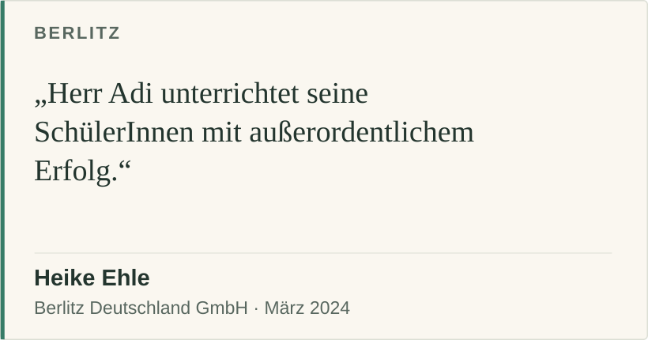
</picture></a>
<a href="./PROOF.md#institutional-references" title="StartSteps: reference and English translation"><picture>
<source media="(max-width: 600px) and (prefers-color-scheme: dark)" srcset="./media/profile-details/reference-startsteps-mobile-dark.svg">
<source media="(max-width: 600px) and (prefers-color-scheme: light)" srcset="./media/profile-details/reference-startsteps-mobile-light.svg">
<source media="(prefers-color-scheme: dark)" srcset="./media/profile-details/reference-startsteps-dark.svg">
<source media="(prefers-color-scheme: light)" srcset="./media/profile-details/reference-startsteps-light.svg">
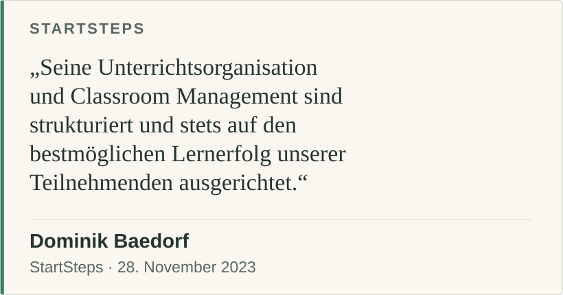
</picture></a>

<a href="./PROOF.md#institutional-references" title="MindRefined: reference and English translation"><picture>
<source media="(max-width: 600px) and (prefers-color-scheme: dark)" srcset="./media/profile-details/reference-mindrefined-mobile-dark.svg">
<source media="(max-width: 600px) and (prefers-color-scheme: light)" srcset="./media/profile-details/reference-mindrefined-mobile-light.svg">
<source media="(prefers-color-scheme: dark)" srcset="./media/profile-details/reference-mindrefined-dark.svg">
<source media="(prefers-color-scheme: light)" srcset="./media/profile-details/reference-mindrefined-light.svg">
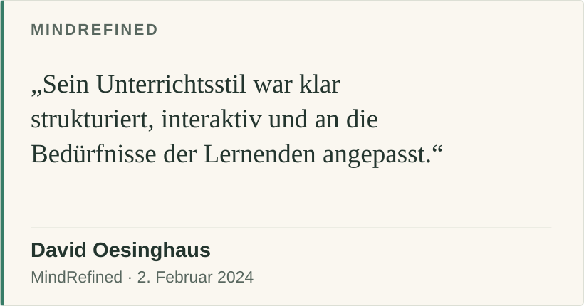
</picture></a>

<strong>Read the institutional excerpts and their source context</strong>

These excerpts come from signed professional reference letters. Names and roles are those on the dated letters; the originals are private documents.

> „Herr Adi unterrichtet seine SchülerInnen mit außerordentlichem Erfolg.“

Heike Ehle, Senior Center Director, Berlitz Deutschland GmbH, March 2024.

English translation: Mr Adi teaches his students with exceptional success.

> „Seine Unterrichtsorganisation und Classroom Management sind strukturiert und stets auf den bestmöglichen Lernerfolg unserer Teilnehmenden ausgerichtet.“

Dominik Baedorf, Programme Lead and Quality Management Officer, StartSteps, 28 November 2023.

English translation: His teaching organization and classroom management are structured and consistently geared towards the best possible learning outcomes for our participants.

> „Sein Unterrichtsstil war klar strukturiert, interaktiv und an die Bedürfnisse der Lernenden angepasst.“

David Oesinghaus, Managing Director, MindRefined, 2 February 2024.

English translation: His teaching style was clearly structured, interactive and adapted to the learners' needs.

<strong>Learner recommendations: technical depth, clarity and different experience levels</strong>

João Teixeira describes how I worked with different experience levels in one class. Ivan Curmi describes making complex coding concepts engaging and understandable. Their complete recommendations, together with those from Vernell Clark and Romano Mantek, are in the [teaching reference record](./PROOF.md#teaching-references).

<a href="./PROOF.md#teaching-references" title="Read João Teixeira's full reference">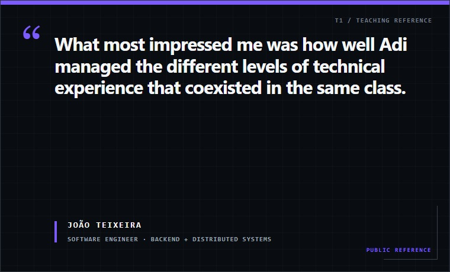</a>
<a href="./PROOF.md#teaching-references" title="Read Ivan Curmi's full reference">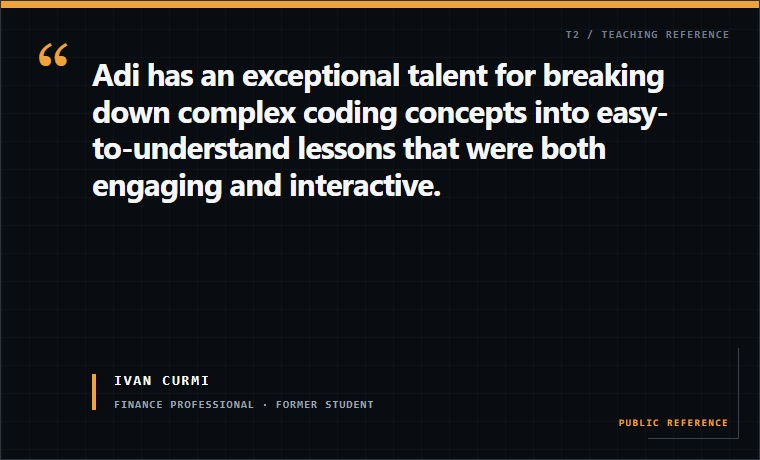</a>

[Read all four original learner references](./PROOF.md#teaching-references) · [LinkedIn recommendations](https://www.linkedin.com/in/codingwithadi/details/recommendations/)

## Public evidence

The work has received recognition, been credited downstream and contributed fixes to other projects. Each source below establishes a specific connection.

| Source | What it records |
|---|---|
| [Snyk: Top 8 Claude Skills for Developers](https://snyk.io/articles/top-claude-skills-developers/) | Lists Planning with Files first and labels its `SKILL.md` verified. That describes the article's order and label, not a security certification. |
| [OpenUI Lab](https://www.openui.com/lab) | Lists OpenUI Forge as a “Tool by Community.” |
| [Daily Dose of Data Science](https://blog.dailydoseofds.com/p/the-next-step-after-karpathys-wiki) | Includes Planning with Files among 16 AI Agent Skills for AI engineers. |
| [CCteam Creator](https://github.com/jessepwj/CCteam-creator) | Explicitly credits Planning with Files for its persistent three-file planning model. |

### Working with other maintainers

- [MemPalace #558](https://github.com/MemPalace/mempalace/pull/558): merged handling for unreachable Windows reparse points, so scans skip inaccessible entries instead of aborting.
- [Composio #21](https://github.com/ComposioHQ/awesome-claude-skills/pull/21): merged LangSmith trace retrieval for debugging LangChain and LangGraph agents.
- [uberSKILLS #67](https://github.com/uberskillsdev/uberSKILLS/pull/67): merged support for importing Claude Code skills without a required `trigger` field.

The [contribution record](./PROOF.md#nine-merged-upstream-contributions) keeps nine selected merged pull requests across six external repositories, including Windows safety, agent observability, platform compatibility and German-language career tooling.

<strong>A maintenance decision: following a Windows compatibility fix through completion</strong>

After the first initializer fix in Planning with Files, I reopened the issue because Windows PowerShell 5.1 still failed to display the requested help. I verified the remaining cases with contributors, documented the compatibility tradeoff, and merged the follow-up after its Windows, macOS, Linux and plugin checks passed.

[Read my review comment](https://github.com/OthmanAdi/planning-with-files/pull/368#issuecomment-6774601294) · [Contributor's merged patch](https://github.com/OthmanAdi/planning-with-files/pull/368) · [Checks for that commit](https://github.com/OthmanAdi/planning-with-files/actions/runs/42403479195)

The patch was authored by Eapp1e. My part in this example was the maintenance decision, verification and merge.

<strong>Contribution and downstream-credit cards</strong>

<a href="./PROOF.md#verified-downstream-credit" title="Inspect the verified downstream credit">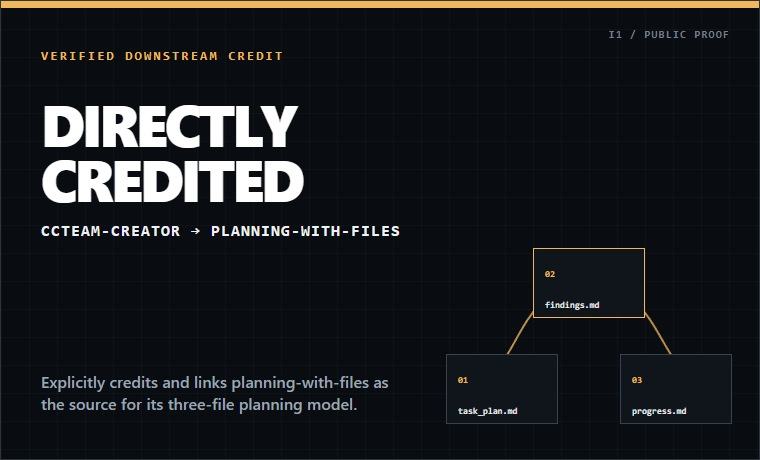</a>
<a href="./PROOF.md#nine-merged-upstream-contributions" title="Inspect nine selected merged upstream contributions">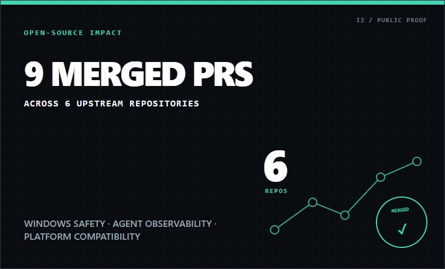</a>

[Open the full evidence record](./PROOF.md) for recognition, direct downstream credit, related implementations, merged contributions, product launch coverage and teaching references. Related implementations are kept separate from projects that explicitly attribute the work.

## Currently in rotation

[Commit FM](https://github.com/OthmanAdi/commit-fm) reads my public push history and shows the repository currently in rotation, with the queue behind it. Its update workflow is scheduled every thirty minutes.

<a href="https://github.com/OthmanAdi/commit-fm" title="Open Commit FM"></a>

## Contact

I'm looking for a senior role building AI agents and products. I'm also interested in hands-on technical leadership and founding-engineer opportunities where I can shape the architecture, work with users and stay responsible for delivery.

Berlin · [Email me](mailto:adiatwork@outlook.com) · [LinkedIn](https://www.linkedin.com/in/codingwithadi) · [Writing on dev.to](https://dev.to/othmanadi)

[Project catalogue](./PROJECTS.md) · [Evidence and recommendations](./PROOF.md) · [Support my open-source work](https://github.com/sponsors/OthmanAdi)

## More repositories

<a href="https://github.com/OthmanAdi/plandeck" title="Plandeck: Visual planning and dependencies"><picture><source media="(prefers-color-scheme: dark)" srcset="./media/profile-details/tile-plandeck-dark.svg"><source media="(prefers-color-scheme: light)" srcset="./media/profile-details/tile-plandeck-light.svg">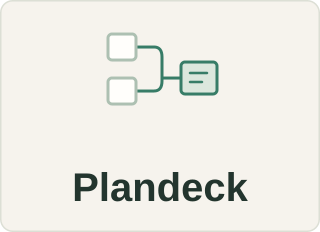</picture></a>
<a href="https://github.com/OthmanAdi/chronos" title="chronos: Time awareness for coding agents"><picture><source media="(prefers-color-scheme: dark)" srcset="./media/profile-details/tile-chronos-dark.svg"><source media="(prefers-color-scheme: light)" srcset="./media/profile-details/tile-chronos-light.svg">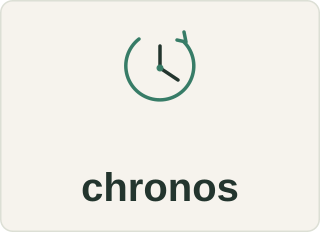</picture></a>
<a href="https://github.com/OthmanAdi/StateAssure" title="StateAssure: Windows metadata scanning"><picture><source media="(prefers-color-scheme: dark)" srcset="./media/profile-details/tile-stateassure-dark.svg"><source media="(prefers-color-scheme: light)" srcset="./media/profile-details/tile-stateassure-light.svg"></picture></a>
<a href="https://github.com/OthmanAdi/skill-deck" title="Skill Deck: A local agent-artifact workbench"><picture><source media="(prefers-color-scheme: dark)" srcset="./media/profile-details/tile-skill-deck-dark.svg"><source media="(prefers-color-scheme: light)" srcset="./media/profile-details/tile-skill-deck-light.svg"></picture></a>
<a href="https://github.com/OthmanAdi/index" title="INDEX: Local governance for agent artifacts"><picture><source media="(prefers-color-scheme: dark)" srcset="./media/profile-details/tile-index-dark.svg"><source media="(prefers-color-scheme: light)" srcset="./media/profile-details/tile-index-light.svg">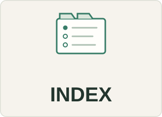</picture></a>

<a href="https://github.com/OthmanAdi/bunbite" title="BunBite: Local browser image optimization"><picture><source media="(prefers-color-scheme: dark)" srcset="./media/profile-details/tile-bunbite-dark.svg"><source media="(prefers-color-scheme: light)" srcset="./media/profile-details/tile-bunbite-light.svg">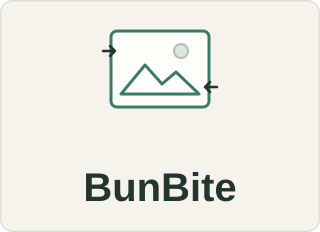</picture></a>
<a href="https://github.com/OthmanAdi/loophole" title="Loophole: Ableton Live tools for agents"><picture><source media="(prefers-color-scheme: dark)" srcset="./media/profile-details/tile-loophole-dark.svg"><source media="(prefers-color-scheme: light)" srcset="./media/profile-details/tile-loophole-light.svg">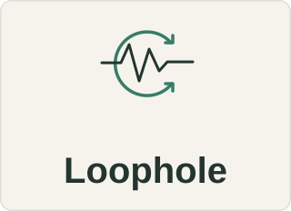</picture></a>
<a href="https://github.com/OthmanAdi/openui-forge" title="OpenUI Forge: OpenUI integration skill"><picture><source media="(prefers-color-scheme: dark)" srcset="./media/profile-details/tile-openui-forge-dark.svg"><source media="(prefers-color-scheme: light)" srcset="./media/profile-details/tile-openui-forge-light.svg">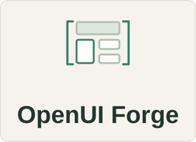</picture></a>
<a href="https://github.com/OthmanAdi/OpenMark" title="OpenMark: Personal knowledge graph"><picture><source media="(prefers-color-scheme: dark)" srcset="./media/profile-details/tile-openmark-dark.svg"><source media="(prefers-color-scheme: light)" srcset="./media/profile-details/tile-openmark-light.svg">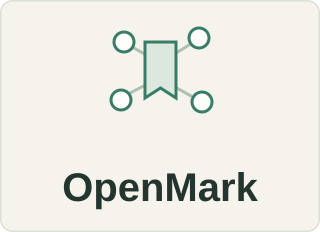</picture></a>
<a href="https://github.com/OthmanAdi/langsmith-fetch-skill" title="LangSmith Fetch: Agent trace retrieval"><picture><source media="(prefers-color-scheme: dark)" srcset="./media/profile-details/tile-langsmith-fetch-dark.svg"><source media="(prefers-color-scheme: light)" srcset="./media/profile-details/tile-langsmith-fetch-light.svg">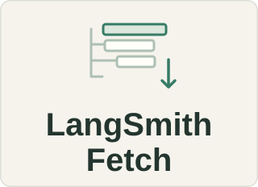</picture></a>

